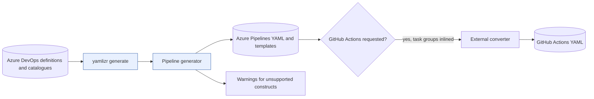

# yamlizr

yamlizr is an Azure DevOps Classic Designer-to-YAML pipeline conversion CLI for teams migrating
Build and Release definitions in bulk. Run it as a .NET global tool or Linux container to produce
Azure Pipelines YAML, with optional GitHub Actions conversion.

[](https://github.com/f2calv/yamlizr/actions/workflows/ci.yml) [](https://sonarcloud.io/dashboard?id=f2calv_yamlizr) [![NuGet version][cascap.yamlizr-badge]][cascap.yamlizr-url]

**Disclaimer**: _Do not consider any of the YAML generated by this tool to be 'production ready'. Do your own testing/research and [post any issues](https://github.com/f2calv/yamlizr/issues) and/or make a PR!_

## Packages and Guides

| Component | Use it for | Delivery |
| --- | --- | --- |
| [yamlizr CLI](src/CasCap.DevOpsYamlizrCli/README.md) | Bulk conversion and output files | [NuGet global tool](https://www.nuget.org/packages/yamlizr), [GHCR image](https://github.com/f2calv/yamlizr/pkgs/container/yamlizr) |
| [CasCap.Api.AzureDevOps](src/CasCap.Api.AzureDevOps/README.md) | REST calls, pipeline models and conversion in .NET applications | [NuGet library](https://www.nuget.org/packages/CasCap.Api.AzureDevOps) |
| [Conversion tests](src/CasCap.Api.AzureDevOps.Tests/README.md) | Offline cases and opt-in live preview validation | Source only |
| [Repository scripts](.scripts/README.md) | Fixture provisioning and editor MCP launcher | Source only; not required to use the CLI |

## Quick Start

Library consumers upgrading to 4.4 must recompile for the
[breaking model-member renames](src/CasCap.Api.AzureDevOps/README.md#migrating-to-44).
The CLI command syntax and generated JSON/YAML wire names are unchanged.

Install the [global tool](https://www.nuget.org/packages/yamlizr) with a .NET 8, 9 or 10 SDK
and matching .NET and ASP.NET Core runtimes (included in the corresponding SDK).
Read the [token permissions](#personal-access-token), then run this
PowerShell 7 example from the directory where you want the output:

```powershell
dotnet tool install --global yamlizr
$env:CasCap__AzureDevOpsOptions__PAT = Read-Host 'Azure DevOps token' -MaskInput
yamlizr generate `
  -org https://dev.azure.com/example-org `
  -proj ExampleProject `
  -out "$PWD\out" `
  --create-directory
```

The generated YAML appears in `out/ExampleProject/`; inspect the warnings and
[conversion limits](#conversion-coverage) before using it. The CLI reads definitions and writes
local files; it does not update Azure DevOps definitions or queue pipelines. Clear the token
environment variable when finished.

## Installation

### Container

The container is the easiest way to run yamlizr because it needs no .NET installation. A
multi-architecture image supporting `linux/amd64`, `linux/arm64` and `linux/arm/v7` is published to
GitHub Container Registry alongside the NuGet package.

```bash
docker pull ghcr.io/f2calv/yamlizr
```

| Tag | Meaning |
| --- | --- |
| `latest` | The most recent release, moves with every release. |
| `4.3.4` | Verified exact release; pin a version for repeatable automation. |

Notes on running the image;

- **Staying current.** `--pull always` re-checks the registry on every run, so a floating tag such as
  `latest` cannot go stale. Omit it once you have pinned an exact version, which never changes.
- **File ownership.** The image runs as a non-root user (uid 1654). On Linux pass
  `--user "$(id -u):$(id -g)"` so the generated files belong to you. This is unnecessary on Docker
  Desktop for Windows or macOS.
- **Use `--create-directory` for unattended runs.** yamlizr appends the project name unless the
  selected output directory already has that name. Creating a missing directory raises an interactive prompt which cannot be answered
  without a TTY. Either pass `--create-directory`, or run with `-it`.
- **Passing the token.** Prefer `--env-file`, or a bare `-e CasCap__AzureDevOpsOptions__PAT` which
  forwards the value from your shell. An inline `-e NAME=value` is visible in `docker inspect` and in
  your shell history.
- Environment forwarding avoids putting the token in the command text, but container inspection
  can still expose environment values. Do not bake credentials into an image.

### .NET Global Tool

If you already have the .NET SDK then the global tool is the lighter option, and it writes directly
to your filesystem with no volume or user mapping to think about.

- Download and install one of;
  - [.NET 8.0 SDK](https://dotnet.microsoft.com/download/dotnet/8.0)
  - [.NET 9.0 SDK](https://dotnet.microsoft.com/download/dotnet/9.0)
  - [.NET 10.0 SDK](https://dotnet.microsoft.com/download/dotnet/10.0)
- From a command line shell install (or update) the tool;

  ```pwsh
  dotnet tool update --global yamlizr
  ```

- Generate YAML into a chosen output folder (the token can come from configuration);

  ```pwsh
  yamlizr generate -org https://dev.azure.com/example-org -proj ExampleProject -out "$PWD\out" --create-directory
  ```

Every example below works with either form. Where a command reads `yamlizr generate ...` the
container equivalent is `docker run --rm ... ghcr.io/f2calv/yamlizr generate ...`.

## Personal Access Token

[Create a Personal Access Token (PAT)](https://docs.microsoft.com/en-us/azure/devops/organizations/accounts/use-personal-access-tokens-to-authenticate?view=azure-devops&tabs=preview-page) with the following scopes/permissions;

| Scope             | Permission    |
| ----------------- | ------------- |
| Build             | Read          |
| Project and Team  | Read          |
| Release           | Read          |
| Task Groups       | Read          |
| Variable Groups   | Read          |

Generation reads definitions; Deployment Groups read/manage is needed by the separate fixture
provisioning script, not the normal conversion path. Start with read scopes and project access
appropriate to the definitions you convert.

The CLI does not save the supplied token, but generated YAML and diagnostics can contain definition
names, variable values and other project content. Protect the output and logs. A pipeline build
service access token is also accepted; see [Running Inside a Pipeline](#running-inside-a-pipeline).
Tokens must be valid, unexpired and authorized for the target project. Follow Microsoft's current
[PAT guidance](https://learn.microsoft.com/en-us/azure/devops/organizations/accounts/use-personal-access-tokens-to-authenticate?view=azure-devops)
for organization policies, expiry and revocation; source inspection is not a live authentication check.

## Usage

For context-sensitive help execute;

```pwsh
yamlizr --help
yamlizr generate --help
```

The [`generate` command](src/CasCap.DevOpsYamlizrCli/Commands/GenerateCommand.cs)
defines these options. Required values may instead come from [configuration](#configuration):

- `-pat|--token` Personal Access Token, or a pipeline access token.
- `-org|--organisation` Azure DevOps organisation Uri, e.g. `https://dev.azure.com/myorg`.
- `-proj|--project` Azure DevOps project name.

Optional arguments;

- `-out|--outputpath` path to the YAML output folder. **Pass it explicitly**: the implementation defaults
  to the application base directory, despite the help text claiming the current directory.
- `--filter <some string here>` only convert definitions whose name contains this text. It is a case-insensitive `contains` match, not a wildcard pattern, so pass `yamlizr.test.` rather than `yamlizr.test.*`.
- `--folder <\Team\App>` only convert build/release definitions in this Azure DevOps folder, including subfolders.
- `--preserve-folders` replicate the Azure DevOps folder structure in the output folders, default `false`.
- `--phasetype` selects the release deployment phase type, default `AgentBasedDeployment`.
  Accepting another enum value does not establish equivalent conversion fidelity.

Optional switches;

- `--inline` merge the tasks from task groups into the steps of the calling job instead of creating additional template files.
- `--githubactions` generate GitHub Actions workflows via [AzurePipelinesToGitHubActionsConverter](https://github.com/samsmithnz/AzurePipelinesToGitHubActionsConverter).
- `--create-directory` create the output folder without prompting, for unattended runs.
- `--parallelism` generate pipelines in parallel.

### Examples

Convert every Build and Release Definition in a project, as a container;

```bash
mkdir -p out
docker run --pull always --rm \
  --user "$(id -u):$(id -g)" \
  -e CasCap__AzureDevOpsOptions__PAT \
  -v "$(pwd)/out:/data" \
  ghcr.io/f2calv/yamlizr:4.3.4 generate -org https://dev.azure.com/example-org -proj ExampleProject -out /data --create-directory
```

This Linux shell example assumes the token environment variable is already exported. Create the
bind-mount directory as your user first; Docker-created directories may not be writable by that user.

Convert only the definitions whose name contains `wibble`, and emit GitHub Actions workflows as well,
as a global tool;

```pwsh
yamlizr generate `
  -org https://dev.azure.com/example-org `
  -proj ExampleProject `
  -out "$PWD\out" `
  --create-directory `
  --filter wibble `
  --githubactions
```

### Output Layout

The output directory gets the project name appended unless its final segment already matches.
Files are named `<sanitized-definition-name>-<id>.yml` and existing matching files are overwritten:

- `<output>/<project>/AzureDevOpsBuilds/*.yml`
- `<output>/<project>/AzureDevOpsReleases/*.yml`
- `<output>/<project>/AzureDevOpsTaskGroups/*.yml` (non-inlined templates, named `<group>-v<major>.yml`)
- `<output>/<project>/GitHubBuilds/*.yml` (with `--githubactions`)
- `<output>/<project>/GitHubReleases/*.yml` (with `--githubactions`)

Use a fresh output directory when comparing runs: files from earlier runs are not cleaned up.
`--githubactions` forces task groups to be inlined. The final summary includes conversion warnings
and collected errors, but the command can still return `0` with conversion errors; a zero exit
code is not proof of complete conversion. See [Conversion Coverage](#conversion-coverage).

## Configuration

The token, organisation and project can also come from configuration, so an unattended run does not
have to put a credential on a process command line. A command line option always wins over a
configured value.

[`AppHost`](src/CasCap.DevOpsYamlizrCli/AppHost.cs) reads sources in this order, each overriding the last:

1. `appsettings.json` alongside the tool
2. `appsettings.json` in the current working directory
3. .NET User Secrets
4. environment variables

The [`AzureDevOpsOptions`](src/CasCap.Api.AzureDevOps/Models/AzureDevOpsOptions.cs)
section supplies connection values. Explicit command options win over configuration; predefined
Azure Pipelines variables are **fallbacks only**, used when both are empty.

## Configuration Examples

Minimal non-secret `appsettings.json` for the working directory:

```json
{
  "CasCap": {
    "AzureDevOpsOptions": {
      "PAT": null,
      "OrganisationUri": "https://dev.azure.com/example-org",
      "Project": "ExampleProject"
    }
  }
}
```

The equivalent environment variables use the standard double-underscore separator, and are what the
container expects;

```pwsh
$env:CasCap__AzureDevOpsOptions__PAT = Read-Host 'Azure DevOps token' -MaskInput
$env:CasCap__AzureDevOpsOptions__OrganisationUri = 'https://dev.azure.com/example-org'
$env:CasCap__AzureDevOpsOptions__Project = 'ExampleProject'
yamlizr generate -out "$PWD\out" --create-directory
```

Never commit a token. Use User Secrets locally and a secret-backed environment variable in CI.

## Running Inside a Pipeline

`--token` also accepts an access token issued to a pipeline's build service identity, so yamlizr can
run as a step in an Azure Pipeline without a Personal Access Token. Grant the build service the
necessary project permissions. Prefer secret-backed environment mapping over a token in arguments.
When options and configuration are absent, yamlizr falls back to the predefined pipeline variables
`SYSTEM_ACCESSTOKEN`, `SYSTEM_COLLECTIONURI` and `SYSTEM_TEAMPROJECT`. The latter two are exposed to
every step automatically, but `SYSTEM_ACCESSTOKEN` is secret and reaches a step only when you map it
explicitly;

```yaml
- script: |
    dotnet tool update --global yamlizr
    yamlizr generate -out $(Build.ArtifactStagingDirectory) --create-directory
  displayName: yamlizr
  env:
    SYSTEM_ACCESSTOKEN: $(System.AccessToken)
```

The container needs no .NET on the agent. Nothing from the agent reaches it unless you forward it, so
the predefined variables above are not available inside the container and the organisation and project
have to be passed as arguments;

```yaml
- script: |
    docker run --pull always --rm \
      --user "`id -u`:`id -g`" \
      -e CasCap__AzureDevOpsOptions__PAT \
      -v "$(Build.ArtifactStagingDirectory):/data" \
      ghcr.io/f2calv/yamlizr generate \
        -org $(System.CollectionUri) \
        -proj $(System.TeamProject) \
        -out /data \
        --create-directory
  displayName: yamlizr
  env:
    CasCap__AzureDevOpsOptions__PAT: $(System.AccessToken)
```

Two details worth keeping;

- `-e NAME` with no value forwards the variable from the step environment, keeping the token out of the
  command text, **not** out of container inspection.
- The user mapping uses backticks because Azure Pipelines resolves its own `$( )` macros before bash
  sees the script. Without it the generated files belong to uid 1654 and the agent cannot clean them up.

## Data Flow

[`GenerateCommand`](src/CasCap.DevOpsYamlizrCli/Commands/GenerateCommand.cs) retrieves classic
definitions plus task and variable catalogues.
[`YamlPipelineGenerator`](src/CasCap.Api.AzureDevOps/Utilities/YamlPipelineGenerator.cs)
produces [`Pipeline`](src/CasCap.Api.AzureDevOps/Models/Yaml/Pipeline.cs) objects, which serialize
through YamlDotNet. Optional GitHub Actions conversion consumes that Azure Pipelines YAML.



## Conversion Coverage

The generator reports unsupported constructs through warnings surfaced by the CLI. Review the
output even when no warning is reported: this is not a completeness guarantee.
Anything marked ❌ below is **absent from the
generated YAML** and must be re-created by hand. Progress on closing these gaps is tracked in
[issue #182](https://github.com/f2calv/yamlizr/issues/182).

✅ converted &nbsp;&nbsp; ⚠️ partially converted &nbsp;&nbsp; ❌ not converted

### Build Definitions

| Classic construct | | Notes |
| --- | :-: | --- |
| Agent phases | ✅ | Each phase becomes a job. |
| Job `dependsOn` | ✅ | Mapped from the phase's declared dependencies, including fan-in, so phases meant to run in parallel still do. |
| Job condition, timeout and cancel timeout | ✅ | |
| Agent queue | ✅ | Becomes the pipeline `pool`. |
| Continuous integration trigger | ✅ | Including branch and path include/exclude filters, and batching. |
| Pull request, scheduled and build completion triggers | ❌ | Reported in the run summary. |
| Server and deployment group phases | ❌ | Only agent phases are converted. |
| A definition with exactly one job | ⚠️ | Flattened to a bare step list, dropping a non-default job condition, see [issue #376](https://github.com/f2calv/yamlizr/issues/376). |

### Release Definitions

| Classic construct | | Notes |
| --- | :-: | --- |
| Environments | ✅ | Each environment becomes a stage named after it. |
| Deploy phases matching `--phasetype` | ✅ | Defaults to `AgentBasedDeployment`. |
| Job `dependsOn` within a stage | ✅ | Sequential, in rank order. |
| Job condition, timeout and cancel timeout | ✅ | |
| Stage `dependsOn` | ❌ | Classic stage dependencies and conditions are not mapped. With no explicit dependency, Azure Pipelines runs stages sequentially in declaration order, not according to the classic graph. |
| Release artifacts | ❌ | A generated release pipeline therefore has no inputs. |
| Pre- and post-deployment approvals and gates | ❌ | Detected and reported, but not converted, see [issue #374](https://github.com/f2calv/yamlizr/issues/374). A generated release pipeline deploys straight through where the classic definition had a gate. |
| Deploy phases other than `--phasetype` | ❌ | Reported per stage. |
| A definition with exactly one stage | ⚠️ | Flattened, dropping stage-level variables and variable groups, see [issue #376](https://github.com/f2calv/yamlizr/issues/376). |

### Steps, Variables and Task Groups

| Classic construct | | Notes |
| --- | :-: | --- |
| Steps for installed tasks | ✅ | With `condition`, `continueOnError`, `timeoutInMinutes` and `env`. |
| Task groups | ✅ | Emitted as template files, or merged into the calling job with `--inline`. |
| Task group parameters | ✅ | Become template parameters. |
| Variables | ✅ | Pipeline, stage and environment scope. |
| Variable groups | ✅ | Emitted as a `group` reference. |
| GitHub Actions workflows | ✅ | With `--githubactions`, via [AzurePipelinesToGitHubActionsConverter](https://github.com/samsmithnz/AzurePipelinesToGitHubActionsConverter). |
| Steps referencing an extension not installed in the organisation | ❌ | Reported by display name and task id. |
| Steps whose task version cannot be parsed | ❌ | Reported by display name and task id. |
| Combined build plus release multi-stage pipelines | ❌ | Build and release definitions are emitted as separate files. |

Azure Pipelines' [default stage ordering](https://learn.microsoft.com/en-us/azure/devops/pipelines/process/stages?view=azure-devops)
is sequential; the CLI's warning describing stages as concurrent should not be taken as the execution
contract. Also re-supply secret values and service connections in the destination rather than assuming
they were exported or migrated.

## Development

The projects target .NET 8, 9 and 10. Use a .NET 10 SDK for the current C# source.
Release configuration uses published shared dependencies; Debug requires sibling source projects.
See the [test guide](src/CasCap.Api.AzureDevOps.Tests/README.md) before choosing offline or live checks,
and the [script guide](.scripts/README.md) before provisioning fixtures.

## License

Released under the [MIT License](LICENSE).

[cascap.yamlizr-badge]: https://img.shields.io/nuget/v/yamlizr?color=blue
[cascap.yamlizr-url]: https://nuget.org/packages/yamlizr
