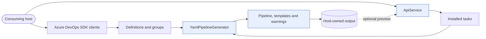

# CasCap.Api.AzureDevOps

Azure DevOps client and conversion library for .NET applications migrating Classic Designer
Build and Release definitions to Azure Pipelines YAML. It supplies the models and generator behind
the [yamlizr CLI](https://github.com/f2calv/yamlizr).

## Installation

```shell
dotnet add package CasCap.Api.AzureDevOps
```

The [NuGet package](https://www.nuget.org/packages/CasCap.Api.AzureDevOps) targets
`net8.0`, `net9.0` and `net10.0`. Use the CLI for ready-made bulk conversion; the library leaves
definition retrieval, catalogue construction, credential acquisition and file output to your host.

The checkout explicitly references supported `System.Security.Cryptography.Xml` to override the
Azure DevOps SDK's older transitive version. This also removes its obsolete drawing dependency
chain. Consumers should not downgrade that dependency; dependency resolution and offline tests
do not establish live Azure DevOps connectivity.

## Migrating to 4.4

Version 4.4 deliberately includes breaking C# model-member renames despite its minor version.
Recompile library consumers and change member access and object initializers to PascalCase:

- `TaskObj`, `TaskInput`, `TaskVersion` and `Tasks`, for example `id` to `Id`,
  `inputMap` to `InputMap`, `defaultValue` to `DefaultValue` and `value` to `Value`.
- `Pipeline`, `StageAzDO` and `TemplateParameter`, for example `stages` to `Stages`,
  `dependsOn` to `DependsOn` and `name` to `Name`. The escaped `@default` member is unchanged.
- `Template.taskGroup` to `Template.TaskGroup`, and `TaskGroupVersion.taskGroupId` /
  `version` to `TaskGroupId` / `Version`. Named constructor arguments for `TaskGroupVersion`
  are now `taskGroupId` and `version`, without the former leading underscores.

The Azure DevOps JSON names and emitted Azure Pipelines YAML names remain unchanged.
`TaskObj.InputMap` is a derived lookup excluded from JSON; populate it from `Inputs` in the host.
CLI commands do not require a corresponding syntax migration. Consumers that cannot migrate
should remain on an earlier immutable package version.

## Quick Start

In a .NET console application, retrieve the installed task catalogue. Supply the token through
your host's secret store or environment, not source code:

```csharp
using CasCap.Abstractions;
using CasCap.Services;
using Microsoft.Extensions.Logging.Abstractions;

var token = Environment.GetEnvironmentVariable("AZURE_DEVOPS_PAT")
    ?? throw new InvalidOperationException("Set AZURE_DEVOPS_PAT.");
IApiService api = new ApiService(NullLogger<ApiService>.Instance, token);
var tasks = await api.GetAllExtensions("https://dev.azure.com/example-org");
Console.WriteLine($"Installed tasks: {tasks?.Count ?? 0}");
```

[`IApiService`](https://github.com/f2calv/yamlizr/blob/main/src/CasCap.Api.AzureDevOps/Abstractions/IApiService.cs)
is implemented by
[`ApiService`](https://github.com/f2calv/yamlizr/blob/main/src/CasCap.Api.AzureDevOps/Services/ApiService.cs).
It accepts a logger and token directly; there is no package-specific DI registration extension.
The client uses Basic authentication with the token and an empty username. Use a valid, authorized,
unexpired PAT or pipeline access token and avoid logging it.

## Public API

| Contract | Consumer responsibility |
| --- | --- |
| [`IApiService.GetAllExtensions`](https://github.com/f2calv/yamlizr/blob/main/src/CasCap.Api.AzureDevOps/Abstractions/IApiService.cs) | Pass the organization URI without a trailing slash; the result can be null. |
| [`IApiService.Validate`](https://github.com/f2calv/yamlizr/blob/main/src/CasCap.Api.AzureDevOps/Abstractions/IApiService.cs) | Supply project, an existing enabled YAML pipeline ID, YAML and optional cancellation token. Returns a validity result, expanded YAML or rejection message. |
| [`YamlPipelineGenerator`](https://github.com/f2calv/yamlizr/blob/main/src/CasCap.Api.AzureDevOps/Utilities/YamlPipelineGenerator.cs) | Supply exactly one full classic build or release definition, installed-task map by ID/major version, task-group map, shared template map and variable-group map. Select inline behavior and release phase type explicitly. |
| [`Pipeline`](https://github.com/f2calv/yamlizr/blob/main/src/CasCap.Api.AzureDevOps/Models/Yaml/Pipeline.cs) | Call `ToString()` to serialize the generated model. |
| [`Template`](https://github.com/f2calv/yamlizr/blob/main/src/CasCap.Api.AzureDevOps/Models/Yaml/Template.cs) | Serialize and persist collected task-group templates when not inlining. |
| [`TaskObj`](https://github.com/f2calv/yamlizr/blob/main/src/CasCap.Api.AzureDevOps/Models/AzureDevOps/TaskObj.cs) | Populate `InputMap` from the task's named inputs before generating. |

For a complete catalogue-to-generator call path, see
[`GenerateCommand`](https://github.com/f2calv/yamlizr/blob/main/src/CasCap.DevOpsYamlizrCli/Commands/GenerateCommand.cs).
For offline definition construction and map shapes, see
[`YamlizrTestData`](https://github.com/f2calv/yamlizr/blob/main/src/CasCap.Api.AzureDevOps.Tests/Tests/YamlizrTestData.cs).

## Behavior and Limits

- One generator instance handles one definition. Read `Warnings` only after `GenPipeline()` returns
  and surface them to the caller. It returns null when nothing is convertible and throws if both
  definition arguments, or neither, are supplied.
- Generated YAML is **not production ready**. Unsupported triggers, artifacts, approvals and gates
  need manual work; flattening can discard stage/job settings. Review the
  [conversion coverage](https://github.com/f2calv/yamlizr/blob/main/README.md#conversion-coverage).
  Warnings do not establish semantic equivalence.
- Preview validation parses YAML without queueing a run. Relative template references resolve
  against the target pipeline's repository; commit templates there or generate with task groups
  inlined. A successful preview does not establish runtime correctness or preserved approvals.
- Both REST methods accept cancellation. Preview HTTP failures become an invalid result; transport
  failures can still throw. No conversion-level retry or rate-limit policy is implemented here.
  Your host must control concurrency and handle Azure DevOps access policies.
- Definitions, generated YAML and diagnostic messages can carry sensitive project content.
  Protect files and log sinks; the library is not a secret-redaction layer.

## Configuration

[`AzureDevOpsOptions`](https://github.com/f2calv/yamlizr/blob/main/src/CasCap.Api.AzureDevOps/Models/AzureDevOpsOptions.cs)
defines the `CasCap:AzureDevOpsOptions` section used by the CLI and tests. Binding alone does not
construct a client or enforce its data annotations; the consuming host supplies validated values.

| Property | Purpose |
| --- | --- |
| [`PAT`](https://github.com/f2calv/yamlizr/blob/main/src/CasCap.Api.AzureDevOps/Models/AzureDevOpsOptions.cs) | Personal Access Token, or an access token issued to a pipeline's build service identity. |
| [`OrganisationUri`](https://github.com/f2calv/yamlizr/blob/main/src/CasCap.Api.AzureDevOps/Models/AzureDevOpsOptions.cs) | Absolute Uri of the Azure DevOps organisation. |
| [`Project`](https://github.com/f2calv/yamlizr/blob/main/src/CasCap.Api.AzureDevOps/Models/AzureDevOpsOptions.cs) | Name of the team project to convert. |
| [`ValidationPipelineId`](https://github.com/f2calv/yamlizr/blob/main/src/CasCap.Api.AzureDevOps/Models/AzureDevOpsOptions.cs) | Optional enabled YAML pipeline ID used by validation callers, not bulk CLI generation. |

## Configuration Examples

Minimal non-secret connection settings (the token is supplied separately):

```json
{
  "CasCap": {
    "AzureDevOpsOptions": {
      "OrganisationUri": "https://dev.azure.com/example-org",
      "Project": "ExampleProject"
    }
  }
}
```

Validation override fragment, merged into that section:

```json
{
  "ValidationPipelineId": 1
}
```

Replace the synthetic ID with a real enabled pipeline. See Microsoft's
[PAT guidance](https://learn.microsoft.com/en-us/azure/devops/organizations/accounts/use-personal-access-tokens-to-authenticate?view=azure-devops)
and the CLI's [permission guidance](https://github.com/f2calv/yamlizr/blob/main/README.md#personal-access-token).

## Data Flow

The host retrieves definitions using Azure DevOps SDK clients and supplies catalogues to the
generator; the REST wrapper does not itself perform bulk conversion.



Essential usage is described above; package renderers may not render Mermaid.

## License

[MIT License](https://github.com/f2calv/yamlizr/blob/main/LICENSE).
