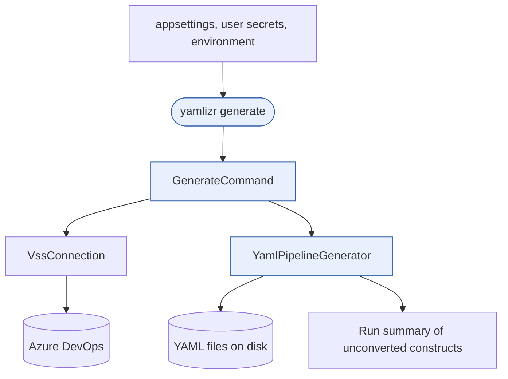

# yamlizr

The `yamlizr` .NET global tool converts Azure DevOps Classic Designer Build and
Release Definitions, and any Task Groups they reference, into Azure Pipelines YAML or GitHub Actions
workflows.

Generated YAML is **not production ready**. Review unsupported constructs, missing approvals/gates
and generated files before putting them into use.

## Quick Start

Install with a .NET 8, 9 or 10 SDK and matching .NET and ASP.NET Core runtimes
(included in the corresponding SDK). The
[NuGet tool](https://www.nuget.org/packages/yamlizr) exposes the `yamlizr` command.

```powershell
dotnet tool install --global yamlizr
$env:CasCap__AzureDevOpsOptions__PAT = Read-Host 'Azure DevOps token' -MaskInput
yamlizr generate `
  --organisation https://dev.azure.com/example-org `
  --project ExampleProject `
  --outputpath "$PWD\out" `
  --create-directory
```

The PowerShell 7 example writes under `out/ExampleProject/`. Clear the environment token afterward.
The [Linux container alternative](https://github.com/f2calv/yamlizr/blob/main/README.md#container)
needs no local .NET installation; verified image platforms are `linux/amd64`, `linux/arm64` and
`linux/arm/v7`.

## Commands

[`Program`](https://github.com/f2calv/yamlizr/blob/main/src/CasCap.DevOpsYamlizrCli/Program.cs)
defines `--help`, `--version` and the required `generate` subcommand.

```shell
yamlizr --help
yamlizr generate --help
```

The [`generate` contract](https://github.com/f2calv/yamlizr/blob/main/src/CasCap.DevOpsYamlizrCli/Commands/GenerateCommand.cs):

| Option | Contract |
| --- | --- |
| `-pat`, `--token` | PAT or pipeline access token; prefer configuration over secret arguments. |
| `-org`, `--organisation` | Absolute organization URI. |
| `-proj`, `--project` | Existing team project name. |
| `-out`, `--outputpath` | Output base directory. Pass explicitly: source uses the application base directory although help says current directory. |
| `--create-directory` | Creates missing output directory without an interactive prompt. |
| `--filter` | Case-insensitive name substring, not a wildcard. |
| `--phasetype` | Release phase type, default `AgentBasedDeployment`; other enum choices are not a fidelity guarantee. |
| `--inline` | Expands task groups into the calling job instead of separate template files. |
| `--githubactions` | Also converts to GitHub Actions; forces task groups inline. |
| `--parallelism` | Parallel conversion; definition retrieval and output already use parallel loops. |

## Behavior and Limits

- Reads Azure DevOps definitions; it does not update them or queue pipelines.
- Appends the project name unless the output directory's final segment already matches it.
  Writes `AzureDevOpsBuilds`, `AzureDevOpsReleases`, and non-inlined `AzureDevOpsTaskGroups`;
  GitHub conversion adds `GitHubBuilds` and `GitHubReleases`.
- Definition filenames contain a sanitized name and ID. Matching files are overwritten; stale files
  from earlier runs are not removed. Treat generated YAML and logs as potentially sensitive.
- Missing credentials, invalid organization URI, project lookup and connection failures return `1`.
  Collected conversion errors and warnings can still end with `0`: inspect the final summary.
- Unsupported triggers, artifacts, approvals, gates and flattening losses need manual review.
  See the detailed [conversion coverage](https://github.com/f2calv/yamlizr/blob/main/README.md#conversion-coverage).
- There is no automatic generated-YAML preview validation in this command and no CLI-level retry or
  rate limiter. A successful conversion is not proof that a pipeline will deploy correctly.

## Configuration

[`AppHost`](https://github.com/f2calv/yamlizr/blob/main/src/CasCap.DevOpsYamlizrCli/AppHost.cs)
layers these sources, later sources winning:

1. `appsettings.json` next to the tool
2. `appsettings.json` in the current working directory
3. .NET User Secrets
4. environment variables

The bindable
[`AzureDevOpsOptions`](https://github.com/f2calv/yamlizr/blob/main/src/CasCap.Api.AzureDevOps/Models/AzureDevOpsOptions.cs)
section is `CasCap:AzureDevOpsOptions`. Explicit command options win over these sources.
When both are empty, `SYSTEM_ACCESSTOKEN`, `SYSTEM_COLLECTIONURI` and `SYSTEM_TEAMPROJECT`
are fallbacks, not overrides. User Secrets are loaded explicitly in every environment.

## Configuration Examples

Minimal working-directory `appsettings.json`, with the token supplied separately:

```json
{
  "CasCap": {
    "AzureDevOpsOptions": {
      "OrganisationUri": "https://dev.azure.com/example-org",
      "Project": "ExampleProject"
    }
  }
}
```

An unattended run can instead supply all connection fields via environment:

```powershell
$env:CasCap__AzureDevOpsOptions__PAT = Read-Host 'Azure DevOps token' -MaskInput
$env:CasCap__AzureDevOpsOptions__OrganisationUri = 'https://dev.azure.com/example-org'
$env:CasCap__AzureDevOpsOptions__Project = 'ExampleProject'
yamlizr generate --outputpath "$PWD\out" --create-directory
```

Use a valid unexpired token with Project and Team, Build, Release, Task Groups and Variable Groups read permissions,
plus the project's required access. See the full
[permission guidance](https://github.com/f2calv/yamlizr/blob/main/README.md#personal-access-token)
and [pipeline token mapping](https://github.com/f2calv/yamlizr/blob/main/README.md#running-inside-a-pipeline).
Never commit a token; container environment values remain inspectable.

## Data Flow

The CLI orchestrates SDK retrieval and library conversion; generated files are local output,
not changes to Azure DevOps.



The diagram is supplemental; registry renderers may not render Mermaid. See the
[library README](https://github.com/f2calv/yamlizr/blob/main/src/CasCap.Api.AzureDevOps/README.md)
for embedding conversion in a .NET host.

## License

[MIT License](https://github.com/f2calv/yamlizr/blob/main/LICENSE).
